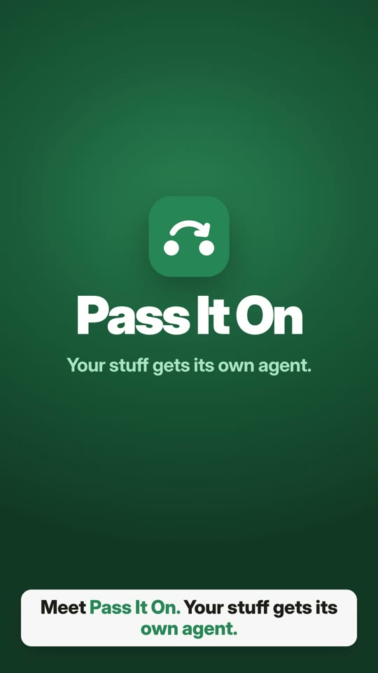
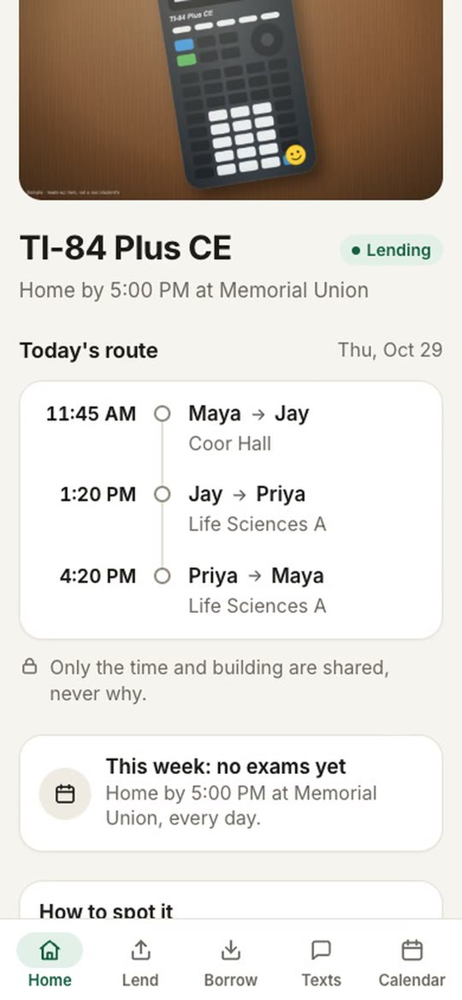
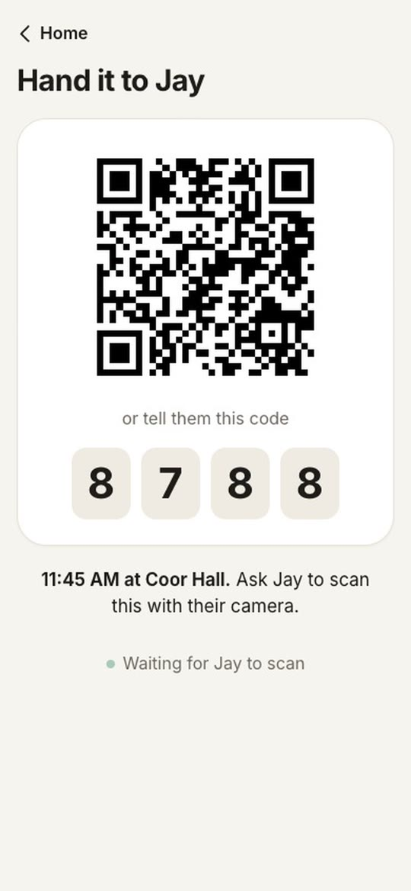
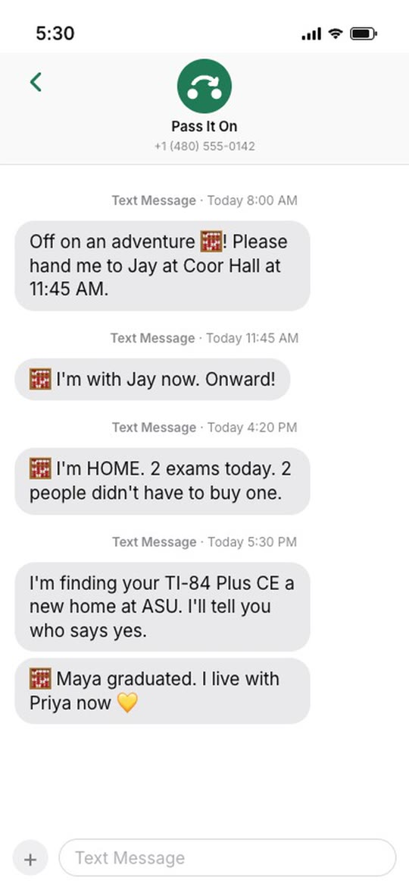

# Pass It On

**Your stuff has an agent now.** A classmate's calculator plans its own day: who needs it for which exam, where to
hand it over, and when it goes home.

Cubbie Hackathon, Track 2 · Built by **Enrollment Goblins**: Shrey Bishnoi and Sumanth Akella

<a href="https://drive.google.com/file/d/1udpUBQXdrY9GO4o798WYyoYqQGYMYvMZ/view"></a>

▶ **[Watch the 1-minute video](https://drive.google.com/file/d/1udpUBQXdrY9GO4o798WYyoYqQGYMYvMZ/view)** ·
[Website](https://shrey-bish.github.io/Pass-it-on/)

## How it works

1. **List it.** Snap a photo. The AI spots the item and the sticker that makes it yours.
2. **Need it.** Your Canvas calendar, or a text like "need a TI-84 Thu 2pm in Durham Hall".
3. **It plans its day** around everyone's exams and walking time, and gets home on time.
4. **Hand it over** with a one-time QR code. Exam moved? It re-plans and asks only who's affected.
5. **Graduating?** It finds a new owner at ASU.

| It plans its day | Hand it over | It texts you |
|---|---|---|
|  |  |  |

## Privacy

Agents share only the item, a time, a building and a yes or no. Never schedules, grades or reasons: `gate.py` blocks
everything else, and a test tries to learn a whole schedule and fails. Handoffs happen only in public campus buildings.

## What Track 2 asks for

| Ask | Where it is |
|---|---|
| Conflicting constraints | Two people need it at once: first to confirm wins, or a second lender steps in. The owner's exams are never broken. Handoffs shift to fit both people's free time. |
| What agents share | Item, time window, building, rating level, yes or no. |
| When it asks to confirm | Owner approves the borrower, the borrower confirms the pickup, both confirm the handoff, and anyone affected confirms a re-plan. |
| Why students need it | Nobody should buy a calculator for one exam. |

## Run it

```
python3.12 -m venv .venv && .venv/bin/pip install -r requirements.txt
cp .env.example .env            # add ANTHROPIC_API_KEY
.venv/bin/uvicorn passiton.app:app --port 8000
```

Open http://localhost:8000/demo for three phones (Maya, Jay, Priya) on the real app. `.venv/bin/pytest` runs 141
tests. The photos, names and calendars in `assets/samples/` are made up.

## Built for Cubbie

When Cubbie supports agent-to-agent messaging, each student's Cubbie becomes their agent here, and their stuff joins
the conversation.
